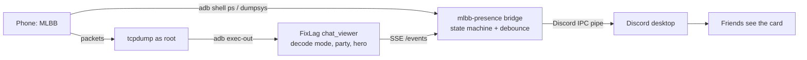

# MLBB Discord Presence — Plan

**Status:** plan only. No code yet.
**Date:** 2026-11-27.
**Goal:** Your Discord profile shows a live card when you play Mobile Legends: Bang Bang (MLBB) on your phone. The card shows the game, the time played, the mode, the party size with a badge, and a "Watch" button that opens your MLBB stream on the viewer's phone.

---

## 0. Short answer: is it possible?

Yes. Most of it is possible now, because the FixLag project already decodes the data. Some parts need tests first.

| Feature | Possible? | How sure | Notes |
|---|---|---|---|
| "Playing MLBB" on your profile | Yes | Sure | Needs a Discord app (free, from the Developer Portal). |
| Time played (timer) | Yes | Sure | Discord counts up from a start time that we send. |
| Game mode (Ranked, Classic, Brawl…) | Yes, from draft pick | Sure | FixLag decodes it today (`pvp_type`, `map_id`). |
| Party size (Solo…5Q) | Yes, from draft pick | Sure | FixLag decodes it today (`ulRoomID` groups). |
| Party badge (small icon) | Yes | Sure | Discord "small image" with hover text. |
| Mode and party size in the **lobby** (before queue) | Maybe | Medium | Lobby data is compressed, not encrypted. It needs research (§3.3). |
| "Watch" button | Yes | Sure | Max 2 buttons. Only web links (`https://`). |
| Button opens MLBB on the viewer's phone | Probably | Medium | MLBB owns verified app links on `applink.mobilelegends.com`. We must test the link format for your live room (§6). |
| Works when your PC is off | Later | Medium | Needs an Android app with the Discord Social SDK (Option B, §4). |

**The honest catches:**

1. The party size and the mode are known only from **draft pick**. In the lobby, the first version shows only "In lobby".
2. The first version needs your **PC on**, with Discord desktop open and the phone connected by ADB.
3. Mode, party size and hero need **root** (packet capture). Your root (DirtyFrag) is lost after each reboot. Without root, the card shows only "Playing MLBB" and the timer.
4. You **cannot see your own buttons**. Discord shows them only to other people. Use a second account or a friend to test.
5. The "Watch" button can open your stream only when you are live, and only when we know your live room link.

---

## 1. Words in this plan

| Word | Meaning |
|---|---|
| **Presence** | Discord "Rich Presence": the card under your name that says "Playing …". (Discord "Activities" are a different thing: games that run inside a voice call. We do not make one of those.) |
| **Bridge** | The small program on your PC that reads the game data and sends the presence to Discord. |
| **Badge** | The small round image on the corner of the big image on the card. |
| **Party size** | The number of players who queued with you: 1 = Solo, 2 = Duo, 3 = Trio, 4 = 4Q, 5 = 5Q. |
| **Phase** | Where you are in the game: Lobby, Draft, Loading, Battle, After match. |
| **App link** | An `https://` link that Android opens in the app directly, when the app is installed. |

---

## 2. What the Discord card can show

The card has these parts. The limits come from the Discord docs and the Gateway API.

```
┌──────────────────────────────────────────────┐
│ PLAYING A GAME                               │
│ ┌────────┐  Mobile Legends: Bang Bang        │  ← app name (Developer Portal)
│ │ LARGE  │  Ranked · Draft pick              │  ← details
│ │ IMAGE  │  Trio queue (3 of 5)              │  ← state + party size
│ │     (B)│  12:34 elapsed                    │  ← timer (start timestamp)
│ └────────┘                                   │
│ [   Watch my stream   ] [  Join my party  ]  │  ← max 2 buttons
└──────────────────────────────────────────────┘
(B) = badge (small image), with hover text
```

| Field | What we put in it | Limit |
|---|---|---|
| App name | "Mobile Legends: Bang Bang" (set once in the Developer Portal) | — |
| `details` | Mode and phase, e.g. "Ranked · Draft pick" | Short text. Discord says "snippets, not sentences". |
| `state` | Party, e.g. "Trio queue" | Short text. |
| `party.size` | `[current, max]`, e.g. `[3, 5]` → Discord shows "(3 of 5)" | Two numbers, min 1. |
| `timestamps.start` | Time when you opened the game (or when the match started) | Discord counts up. |
| `large_image` + `large_text` | Mode art or your hero portrait, with hover text | Uploaded asset key or external `https` image. |
| `small_image` + `small_text` | The party badge, hover text "Trio queue" | Same as above. |
| `buttons` | Up to 2: label + URL | Max 2. Label 1–32 characters. URL max 512 characters. Only `http`/`https` in practice. |
| `type` | Playing (default). Maybe "Competing" for Ranked. | Test it in Phase 0. |
| `status_display_type`, `details_url`, `state_url` | Newer fields: what the member list shows, and clickable text | Test it in Phase 0. |

**Assets:** Upload up to 300 images per Discord app (1024 × 1024 recommended). External `https` image URLs also work, also GIF and animated WebP.

**Update speed:** Send an update only when something changes. Send not more than 1 update every 15 seconds. (The Gateway limit for bots is 5 updates per 20 seconds. The Rich Presence docs do not give a limit, so we stay safe.)

**Who sees it:** Everyone who can see your profile, when your "Share my activity" setting is on. The card shows on desktop and on mobile Discord.

---

## 3. Where the data comes from

### 3.1 What we already know (from FixLag, measured)

The FixLag project (`C:\Users\child\PROJECTS\FixLag`) already did the hard work:

- **Root over ADB works.** `adb shell` gets root directly (KernelSU allowlist has `com.android.shell`). See `FixLag/docs/handoff.md` §3.
- **Passive capture works.** `tcpdump` runs on the phone. `tools/chat_viewer` reads it live with `adb exec-out` and decodes the match.
- **Mode is decoded.** Messages `mid=1242` and `mid=1230` carry `iPVPType` and `uiMapID`. `format_mode_label()` in `FixLag/tools/chat_viewer/session.py` turns them into "Ranked", "Classic", "Brawl", "Custom Draft" and more.
- **Party size is decoded.** The roster messages (`mid=1230`, `1202`, `1203`) give each player a `ulRoomID`. Players in the same camp with the same room ID queued together. `_format_party_label()` gives "Solo", "Duo", "Trio", "4-stack", "5-stack". It hides the label in Custom rooms.
- **Hero is decoded.** `hero_id` and `hero_name` per player.
- **Phases are decoded.** `IDLE → DRAFT → LOADING → BATTLE`.
- **The match server connects at draft pick**, not at the accept screen. So the data starts at draft pick.
- **Lobby traffic (TCP port 30101) is compressed (Zstd), not encrypted.** It holds "lobby/party/roster data". `FixLag/tools/lag_mapper/tcp_lobby.py` already decompresses it.
- **The chat viewer publishes live events.** `python -m tools.chat_viewer --adb <serial>` serves `http://127.0.0.1:<port>/events` (SSE). The `match_new` and `match_update` events carry `phase`, `mode_label`, `local_party_size`, `party_label`, `players` (with heroes) and timestamps.

**Gaps in FixLag today:**

- No "match ended" event. We must add it (no packets on the match stream for ~20 s = match ended).
- No win/loss. Unknown if the result is on the wire.
- No lobby party size. Needs research in the TCP 30101 data.

### 3.2 "MLBB is open" and the timer (no root needed)

The `adb shell` user can see all processes without root:

```powershell
adb -s <serial> shell "ps -A -o PID,ETIME,NAME | grep com.mobile.legends"
adb -s <serial> shell "dumpsys activity activities | grep topResumedActivity"
```

- `ps` shows if the game runs, and for how long (`ETIME`). So the timer is correct even if the bridge starts late.
- `dumpsys` shows if the game is on screen. We can show "Idle" when the game is in the background.
- The engine process is `com.mobile.legends:UnityKillsMe` (from FixLag notes).

This part works after a reboot too, because it needs no root.

### 3.3 Lobby state (research)

Goal: show the mode and the party size **before** draft pick (in the lobby and in the queue).

The lobby TCP stream (port 30101) is Zstd-compressed and carries party and roster data. FixLag decodes only a few message IDs (`20008`, `10144`, `11169`, `11499`, `10017`). Work for Phase 3:

1. Capture the lobby while you invite 1, 2, 3 and 4 friends, and while you change the mode.
2. Diff the decompressed frames. Find the message ID that changes with the party member count.
3. Add a decoder. Keep the FixLag rule: skip `mid=10208` and redact e-mails and tokens.

Until then, a **manual switch** in the tray menu sets the party size in the lobby.

### 3.4 What we will NOT do

These ideas are possible, but the risk is too high. Do not use them in this project:

| Idea | Why not |
|---|---|
| Read game memory (Frida, `dump.cs` offsets) | MLBB has anti-cheat. Memory access can get your MLBB account banned. FixLag used Frida only for research. The rule for this project is **passive capture only**. |
| Change the game (mods, patched APK, hooks) | Same ban risk, and it breaks on each update. |
| Set the presence with your Discord **user token** (apps like "Kizzy") | This is a "self-bot". It is against the Discord Terms. It can get your Discord account banned. |
| Screen reading (OCR) | It works without root, but it is slow, uses battery, and breaks on each UI change. Keep it only as a last fallback. |

The `dump.cs` file is still useful as a **map**: it shows class names and link handlers (§6). We read it on the PC. We never touch the running game.

---

## 4. The options

### Option A — PC bridge (recommended first)



- **How:** A Python program on your PC. It reads the FixLag chat viewer events and the ADB process list. It sends the presence to Discord desktop through the local pipe (`\\.\pipe\discord-ipc-0`).
- **Good:** It uses Python code that already works and has tests. It is fast to build (Phase 1 is about one or two evenings). No token. Allowed by Discord.
- **Bad:** The PC must be on, with Discord desktop open, and the phone on wireless ADB.

### Option B — Android app (later, no PC)

- **How:** A small Kotlin app on your phone with the **Discord Social SDK** (version 1.10 or newer). On Android, the SDK can publish presence through the Discord app on the same phone. It needs no account linking and no token. The Discord app must be installed and signed in.
- **Data:** The app runs `tcpdump` with root (library `libsu`), or it uses only "game open + timer" when root is gone.
- **Good:** No PC. It works anywhere.
- **Bad:** Much more work. We must port the Python decoders to Kotlin. Android may stop background apps, so the app needs a foreground service (a small notification).

### Option C — user token / self-bot (rejected)

See §3.4. Do not do it.

**Recommendation:** Build Option A first. Use it for a few weeks. If the PC need is a real problem, build Option B and reuse the same presence design.

---

## 5. Presence design

### 5.1 States

| Phase | `details` | `state` | Large image | Badge | Timer |
|---|---|---|---|---|---|
| Game in background | "Idle" | — | MLBB art | — | session |
| Lobby | "In lobby" | Manual party size, or empty | MLBB art | Manual, or none | session |
| Draft pick | "Ranked · Draft pick" | "Trio queue" + `(3 of 5)` | Mode art | TRIO | session |
| Loading | "Ranked · Loading" | "Trio queue" + `(3 of 5)` | Mode art | TRIO | session |
| Battle | "Ranked · In match" | "Trio queue" + `(3 of 5)` | **Your hero portrait**, hover "Playing as Ling" | TRIO | match |
| After match (60 s) | "Ranked · Match ended" | "Trio queue" | Mode art | TRIO | — |
| Custom room | "Custom match" | — | Mode art | — | session |
| Live on (manual switch) | same as above | same | same | same | same, plus the **Watch** button |

**Timer choice:** One timer only. The default is the session timer ("how long have I been playing"). An option switches to the match timer during Battle.

**Ranked "Competing":** If Discord accepts `type = Competing` from the pipe, Ranked shows "Competing in Mobile Legends". Test it in Phase 0.

### 5.2 Badges

Five round badges, 1024 × 1024 PNG, uploaded as assets `queue_1` … `queue_5` (person icons: 1 to 5 people):

| Size | Label | Idea for the art | Hover text |
|---|---|---|---|
| 1 | SOLO | One person, grey-blue | "Solo queue" |
| 2 | DUO | Two people, green | "Duo queue (2 of 5)" |
| 3 | TRIO | Three people, purple | "Trio queue (3 of 5)" |
| 4 | 4Q | Four people, orange | "4-queue (4 of 5)" |
| 5 | 5Q | Full team, gold with a crown | "Full 5-queue (5 of 5)" |

- The badge is small (about 20–30 px on screen). Use a thick bold label and strong colours. Thin lines do not show.
- Make your own art. Do not copy MLBB rank icons or Moonton art into the badges.
- Mode art (large image): one image per mode (`mode_ranked`, `mode_classic`, `mode_brawl`, …).
- Hero portraits: about 130 heroes. They fit in the 300-asset limit. Or use external `https` image URLs.

### 5.3 Privacy switches (tray menu)

- Pause the presence.
- Hide the mode.
- Hide the party size.
- "I am live" on/off (shows the Watch button).
- "Show Join button" on/off.

---

## 6. The "Watch" button

### 6.1 What we found

**MLBB link handlers on your phone** (read with `adb shell dumpsys package com.mobile.legends`, MLBB `2.2.23.12351`, 2026-11-27):

| Link | Opens | Notes |
|---|---|---|
| `mobilelegends://…` | MLBB main activity | Custom scheme. Discord buttons do not accept it. |
| `mlbb://onpageresponse` | MLBB browser redirect | Internal. |
| `https://applink.mobilelegends.com/…` | MLBB main activity | **Verified app link** (`AutoVerify=true`). Android opens MLBB directly. |
| `https://play.mobilelegends.com/landing/` | MLBB main activity | Verified app link, one path only. |

**Link code in `dump.cs`** (`FixLag/data/01_dump.cs`):

- `DeeplinkManager` has `OpenDeepLink(path)`, `OpenAppLink(url)`, `HandleAppLinkLua(path)`, `GetDeepLink(linkType)`, `GetShareWhatsAppDeepLink(shareType)`.
- It has handlers `OpenTeamJoin`, `OpenTeamMatch`, `OpenCircleJoin`, `OpenHeroInfomation`, `OpenAppointment`.
- Static fields `m_bCreateRoomDeeplink`, `m_bDeeplinkRoomId`, `m_bDeeplinkMatchId` exist.
- Live code: `TryOpenLiveStreamView(tabType, subTabType, enteryType, delayOpen)` and `SendLiveShareRewardCS(shareType)`. So the game has a **share action for Live**.
- `ConvertShortShareUrlToDeeplinkPath(shortUrl)` turns short share links into link paths.
- **The path strings are in the Lua scripts, not in `dump.cs`.** So `dump.cs` cannot tell us the exact live room link.

### 6.2 How we get the real link (Phase 0 test)

1. Start a Live in MLBB.
2. Tap **Share** on your live room. Pick "Copy link" (or share to WhatsApp and copy it there).
3. Look at the link. We expect `https://applink.mobilelegends.com/…` or a short link.
4. Test it on your phone:
   ```powershell
   adb -s <serial> shell am start -a android.intent.action.VIEW -d "<the link>"
   ```
5. Test it on the second phone (the Infinix) as a viewer. Use a different MLBB account there.
6. Test a tap from Discord mobile on the Infinix (from a second Discord account).
7. Write the results in `docs/findings.md`.

Also check if the live room link stays the same each time you go live. If it stays the same, we can save it once.

### 6.3 The link chain

**Case 1 — the share link is an `applink.mobilelegends.com` link:** Put it straight into the button. On Android, the verified app link opens MLBB. If MLBB is not installed, the browser opens the MLBB web page.

**Case 2 — the share link is a custom scheme or does not open MLBB from Discord:** Host a small redirect page (free, on Cloudflare Pages or GitHub Pages):

| Viewer device | What the page does |
|---|---|
| Android | Shows a big "Open in MLBB" button. The button uses `intent://…#Intent;scheme=…;package=com.mobile.legends;S.browser_fallback_url=<Play Store>;end`. |
| iPhone | Tries the app link. Falls back to the App Store. |
| PC | Shows a **QR code** and "Scan this with your phone". |

Note: Chrome opens `intent://` links only after a user tap. So the page needs a button. It cannot jump by itself.

### 6.4 Limits of the Watch button

- The viewer must have MLBB installed and logged in.
- The Discord in-app browser can block the jump to the app. Test it (§6.2 step 6).
- The button URL is fixed for each presence update. We show the button only when "I am live" is on.
- Friend-list spectate (watch a friend's match) is not a link. We cannot open it from a button.

### 6.5 Bonus: "Join my party" button

`OpenTeamJoin` in `dump.cs` means MLBB has team-invite links. MLBB can share a team invite from the lobby. A second button "Join my party" can show when your party has free slots. Keep it **off** by default. Everyone who sees your profile can tap it.

---

## 7. Tools

### 7.1 Option A (PC bridge)

| Tool | Use |
|---|---|
| Python 3.12+ | The bridge. Same language as FixLag. |
| FixLag `tools/chat_viewer` | Decodes mode, party, hero and phase. We read its `/events` stream. We do not change FixLag in Phase 1. |
| `httpx` (or `aiohttp`) | Reads the SSE stream. |
| `pypresence` | Sends presence to Discord desktop. If it does not support the newer fields, write a small IPC client (about 100 lines: handshake, then `SET_ACTIVITY` frames on the named pipe). |
| `adb` (platform-tools) | `ps`, `dumpsys`, `exec-out tcpdump`. Always use `-s <serial>`. |
| `pystray` + `Pillow` | Tray icon with the privacy switches. |
| `pytest` | Tests for the state machine and the presence mapping. |
| Discord Developer Portal | Make the app, set the name, upload the badges and mode art, get the Application ID. |
| Figma, Canva or Inkscape | Draw the badges. Export 1024 × 1024 PNG. |
| Cloudflare Pages or GitHub Pages | The redirect page (only if Case 2 in §6.3). |

### 7.2 Option B (Android app, later)

| Tool | Use |
|---|---|
| Android Studio + Kotlin | The app. |
| Discord Social SDK for Android (1.10+) | Publishes presence through the Discord app on the phone. |
| `libsu` (topjohnwu) | Runs `tcpdump` as root from the app. |
| `UsageStatsManager` | "Is MLBB on screen" without root. |
| Foreground service + Quick Settings tile | Keeps the app alive. One tap sets the party size or "I am live". |

---

## 8. Build phases

### Phase 0 — Proof tests (one evening)

1. Make the Discord app in the Developer Portal. Name it "Mobile Legends: Bang Bang". Copy the Application ID into `.env` (not in git).
2. Write a 20-line test script. Send fixed text, `party = (3, 5)`, a test badge, and two buttons.
3. Look at the card from a second Discord account, on PC and on phone. Check that the buttons show on mobile.
4. Test the button URLs: an `https://applink.mobilelegends.com/…` link and a `mobilelegends://` link (we expect the second one to fail).
5. Test `type = Competing` and `status_display_type`.
6. Get your live room link and test it (§6.2).
7. Run the FixLag chat viewer during one Ranked, one Classic and one Brawl match. Check `mode_label` and `party_label`.

**Done when:** `docs/findings.md` has a clear yes or no for each test.

### Phase 1 — MVP bridge

1. Make the project: `mlbb_presence/` package, `pyproject.toml`, `.env.example`, tests.
2. **Game watcher:** poll `adb shell ps` every 5 s. Get "running", "on screen" and the start time.
3. **Match watcher:** read the chat viewer `/events`. Keep the last `match_update`.
4. **State machine:** join both inputs into one `GameState` (phase, mode, party size, hero, times).
5. **Match end:** no match update for 20 s after Battle → "After match" for 60 s → "Lobby".
6. **Mapper:** `GameState` → presence fields (§5.1). Pure function, fully tested.
7. **Sender:** connect to Discord. Send only on change. Not more than once per 15 s. Reconnect if Discord restarts. Clear the presence when the game closes.
8. **Fallback:** no root or no chat viewer → only "Playing MLBB" and the timer.

**Done when:** One full evening of matches shows the correct mode, badge and timer to a second account, with no crash.

### Phase 2 — Watch button and badges

1. Draw the 5 badges and the mode art. Upload them.
2. Add the "I am live" switch and the Watch button.
3. Build the redirect page only if Phase 0 says it is needed (§6.3 Case 2).
4. Add the tray icon with the privacy switches.

**Done when:** A friend taps "Watch" on Discord mobile and lands in your MLBB live room.

### Phase 3 — Lobby and hero

1. Research the lobby party size in TCP 30101 (§3.3).
2. Show the hero portrait and "Playing as <hero>" in Battle.
3. Research the match result (win/loss) on the wire. Use it only if the data is clear.

**Done when:** The badge shows in the lobby without the manual switch.

### Phase 4 — Comfort

1. Start with Windows (autostart). Start the chat viewer as a child process.
2. Reconnect wireless ADB by itself (reuse `FixLag/tools/lag_mapper/wireless_adb.py`).
3. Move the shared decoders from FixLag into one small shared package, so both projects use the same code.
4. Write the README with the setup steps.

### Phase 5 — Android app (optional)

Build Option B (§4) only if the PC need is a real problem after some weeks of use.

---

## 9. Risks and limits

| Risk | Effect | What we do |
|---|---|---|
| Root is lost after a reboot | No mode, party or hero | Fallback to "Playing MLBB" + timer. Re-run DirtyFrag when you want full data. |
| Wireless ADB gives root to anyone on the same Wi-Fi | Security | Use only trusted Wi-Fi (FixLag already has a trusted list). Turn wireless debugging off when you do not play. |
| An MLBB update changes the packet format | Wrong or empty fields | The bridge shows only the fields it is sure of. Tests with saved captures catch changes. |
| The live room link format changes | Watch button breaks | Keep the link in one config file. Test after each MLBB update. |
| Discord changes the pipe or the fields | Presence stops | `pypresence` gets updates. Our own IPC client is small and easy to fix. |
| Moonton art in the assets | IP concern | Use your own badge art. Keep the Discord app private (do not list it in the App Directory). |
| Phone battery and heat | Small | `tcpdump` with a port filter uses little CPU. Measure it in Phase 1. |
| You cannot see your own buttons | Test confusion | Always test with a second account. |

---

## 10. Ideas to make it more fun

1. **Hero portrait** as the large image in Battle, with "Playing as Ling" on hover. (Data exists.)
2. **"Join my party" button** when the party has free slots. (Off by default.)
3. **Today counter** on hover: "Match 4 today". Add "3W 1L" only if the result decode works.
4. **Server and ping** on hover: "Jakarta · 24 ms". The FixLag lag mapper already measures this.
5. **Party flags** on hover: "Party: ID, MY, SG". (Off by default. It shows your friends' countries.)
6. **"Competing in Ranked"** with the Competing activity type.
7. **After-match card** for 60 s: "Just finished a Ranked match".
8. **QR code** on the redirect page for PC viewers.
9. **Discord webhook** (optional): post "Hora is live in MLBB" with a Watch link to your own server. Keep the webhook URL in `.env`.
10. **Animated badge** for 5Q (GIF or animated WebP by external URL).
11. **Streamer mode:** one switch hides everything except "Playing MLBB".

---

## 11. Questions for you

1. Is "my MLBB stream page" the **in-game Live** room? Or a YouTube/TikTok stream?
2. Which timer do you want: the session (since the game opened) or the current match?
3. Badge labels: "SOLO / DUO / TRIO / 4Q / 5Q"? Or other words?
4. Do you want the "Join my party" button at all?
5. Is the PC usually on when you play? (This decides if Option B is needed soon.)
6. Do you have a second Discord account for tests? Or a friend who can help?

---

## 12. Sources

- FixLag research and tools: `C:\Users\child\PROJECTS\FixLag` (`HANDOFF.md`, `docs/handoff.md`, `docs/chat-research.md` §9.4, `tools/chat_viewer/session.py`, `tools/lag_mapper/tcp_lobby.py`).
- MLBB class map: `C:\Users\child\PROJECTS\FixLag\data\01_dump.cs` (`DeeplinkManager`, `LiveStreamHelper`, `TryOpenLiveStreamView`).
- MLBB link handlers: `adb shell dumpsys package com.mobile.legends` on SM-S936B, MLBB 2.2.23.12351, 2026-11-27.
- Discord Social SDK, mobile: https://docs.discord.com/developers/discord-social-sdk/core-concepts/mobile
- Discord Social SDK, setting Rich Presence: https://docs.discord.com/developers/discord-social-sdk/development-guides/setting-rich-presence
- Discord Rich Presence best practices: https://docs.discord.com/developers/rich-presence/best-practices
- Discord Rich Presence how-to: https://docs.discord.com/developers/rich-presence/how-to
- Discord Gateway activity object (button and update limits): https://docs.discord.com/developers/events/gateway-events
